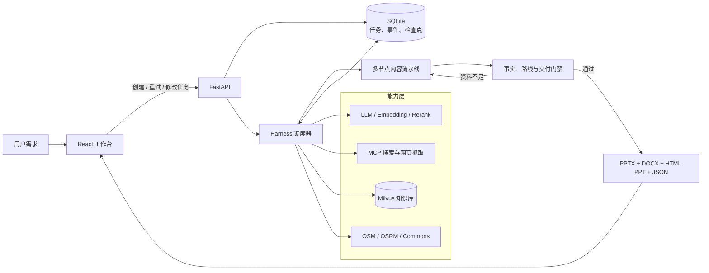
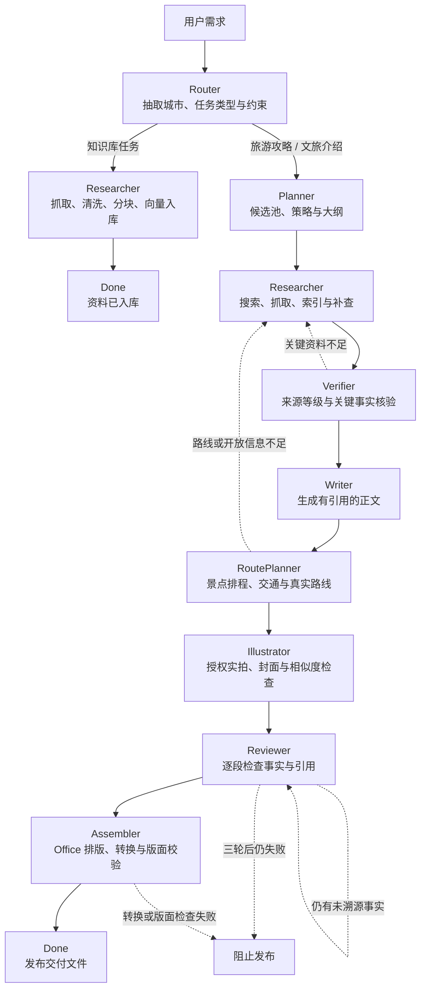
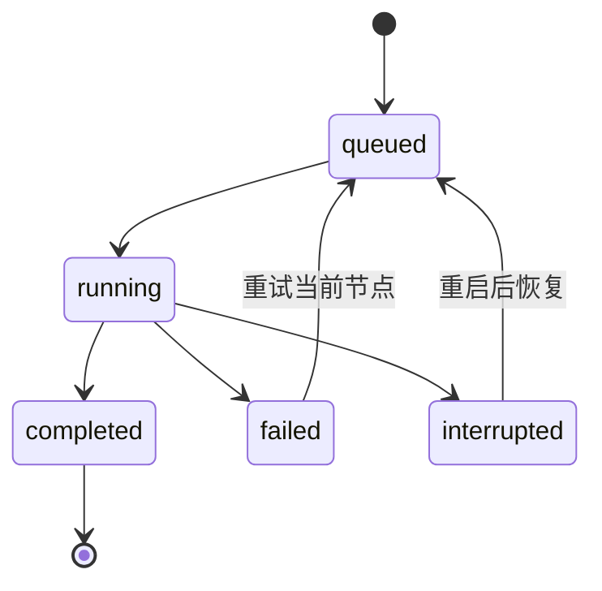
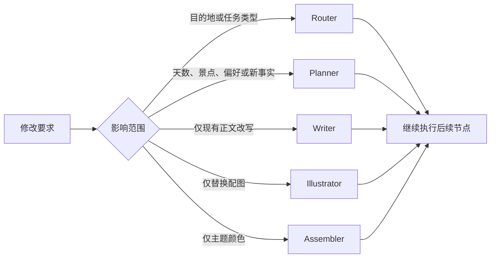
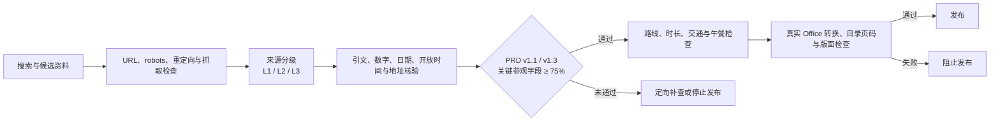
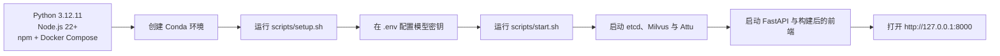

# Travel Harness

Travel Harness 是知行文旅 Agent 的执行底座：把旅游攻略或城市文化研究整理成同源的
PPTX、DOCX、HTML PPT 与结构化 JSON。

前端使用 React 18、TypeScript 和 Vite；后端使用 FastAPI、Python 3.12.11、
SQLite 与 Milvus。任务由可恢复的多节点流程执行，关键事实必须经过来源核验，
Office 文件必须通过真实转换和版面检查后才能发布。

> **当前状态**：项目是可运行的首版，尚未完成 PRD 第 14 章的全部交付验收。
> 模型密钥是可运行生成链的前置条件；缺少密钥时界面、历史与知识库可打开，
> 但生成会明确失败，不会用预置内容伪造成功。

仓库地址：<https://github.com/chensishen/travel-harness>

## 总览



## 生成流程

旅游攻略与文旅介绍采用同一条内容生产链。知识库导入任务只执行前三个节点。



各节点的职责：

| 节点 | 主要输出 | 失败或回退方式 |
| --- | --- | --- |
| `Router` | 城市、任务类型、天数、人数、预算、日期与偏好 | 城市不明确时拒绝编造并要求补充 |
| `Planner` | 候选池、内容策略、景点与章节大纲 | 偏好或目的地变化时从这里重跑 |
| `Researcher` | 来源、正文、分块、向量与缓存 | 接收定向补查请求 |
| `Verifier` | 来源等级、引文、日期、数字与字段核验 | 资料不足时回到 `Researcher` |
| `Writer` | 带来源编号的正文与实用信息 | 仅文字修改时可从这里重跑 |
| `RoutePlanner` | 每日顺序、真实路网、时间预算与 GeoJSON | 行程不可执行时回到 `Researcher` |
| `Illustrator` | 合规实拍、封面与图片来源记录 | 无合格图片时明确降级 |
| `Reviewer` | 正文审计、修正与删除记录 | 无法溯源的正文不能发布 |
| `Assembler` | PPTX、DOCX、HTML PPT、PDF 预览与 JSON | 转换或检查失败时阻止出件 |

## 任务状态与恢复

任务状态、事件编号和检查点保存在 SQLite。SSE 断线后可以按事件编号续传，
前端同时保留轮询兜底。



修改任务会创建新版本并保留旧文件。`Revision` 先判断影响范围，再从最早受影响的节点重跑：



## 事实与交付门禁



主要规则：

- 票价、开放时间、预约与地址只接受可回查的 L1 / L2 来源。
- 正文引用来源编号；审阅器检查引用是否存在、数字是否一致、事实是否过期。
- 三轮审阅仍无法核实的段落会被省略并记录；仍有阻断问题时不发布。
- 行程默认从下一个周六开始，每天 09:00 排程，活动、交通、等待与用餐合计不超过 10 小时。
- 步行与驾车使用不同的真实路网来源；驾车时间不能折算为公共交通时间。
- 景点图优先使用有作者、许可和页面记录的授权实拍；没有合格图片时明确降级。
- Word 目录使用真实 PDF 页码更新；PPTX、DOCX 与 HTML PPT 均需通过最终文件检查。

## 快速启动



```bash
conda env create -f environment.yml
conda activate travel-harness
PYTHON_BIN="$(command -v python)" ./scripts/setup.sh
```

安装脚本会创建 `.venv`、安装锁定依赖、构建前端，并下载思源黑体到被忽略的
`data/fonts/`。若 `.env` 不存在，会从 `.env.example` 创建。

在 `.env` 中至少配置：

```dotenv
LLM_API_KEY=你的本机网关密钥
SILICONFLOW_API_KEY=你的硅基流动密钥
```

不要提交真实密钥。模型地址、模型 ID、Milvus、MCP、OSRM 与并发参数均可在
`.env` 中调整。

```bash
./scripts/start.sh
```

默认地址为 `http://127.0.0.1:8000`，API 文档为 `/docs`。应用只绑定本机地址。

```bash
# 更换应用端口
PORT=8765 ./scripts/start.sh

# 已单独启动依赖时，只启动 Web 服务
SKIP_DOCKER=1 PORT=8765 ./scripts/start.sh
```

若本机 19530 已被其他项目占用，请在 `.env` 使用其他 Milvus、健康检查与 Attu 端口。
不要复用其他项目的数据库卷。

## 开发与检查

```bash
# 后端开发服务
.venv/bin/python -m uvicorn backend.app.main:app --reload \
  --host 127.0.0.1 --port 8000

# 另一个终端：前端开发服务，将 /api 代理到 8000
cd frontend
npm run dev
```

```bash
# 后端静态检查与测试
.venv/bin/ruff check backend scripts
.venv/bin/python -m pytest -q

# 可选：连接独立测试 Milvus
MILVUS_TEST_URI=http://127.0.0.1:19540 .venv/bin/python -m pytest -q

# 前端生产构建
cd frontend
npm run build
```

Milvus 集成测试使用随机命名的独立数据库和合成向量，结束后删除测试库，
不会向正式知识库预置数据。

## 服务探测

```bash
.venv/bin/python scripts/smoke.py
```

探测内容包括 Python、LLM 文本与 JSON、图片输入、文本与图片 Embedding、
Reranker、MCP 工具发现、Nominatim 与 OSRM。报告写入 `data/smoke.json`；
真实 `tools/list` 结果写入 `docs/mcp_tools.md`。

默认从 `~/.codex/config.toml` 读取 MCP 配置，也可通过 `MCP_CONFIG_PATH`、
`MCP_SEARCH_SERVER` 和 `MCP_FETCH_SERVER` 覆盖。

## 目录结构

```text
backend/app/         FastAPI、SQLite、异步任务、SSE
backend/harness/     Schema、节点编排、事实与路线规则
backend/tools/       LLM、MCP、网页、地理编码、OSRM、图片
backend/kb/          URL 去重、分块、Embedding、Milvus、Rerank
backend/render/      同源文档、真实底图、Office 转换与质量检查
backend/tests/       单元测试、API 测试与可选 Milvus 集成
frontend/            React 工作台
docker/              独立 Milvus、Attu 与可选 OSRM
docs/                实施、验收、性能与问题修复记录
scripts/             安装、启动、冒烟、回归与基准脚本
third_party/         HTML PPT 生成依赖
data/                本机运行数据、缓存与产物（不进入 Git）
```

## 文档入口

- [实施记录](docs/implementation.md)
- [PRD v1.1 整改报告](docs/prd-v1.1-validation.md)
- [性能实施记录](docs/performance-implementation.md)
- [HTML PPT 实施记录](docs/html-ppt-implementation.md)
- [完整功能浏览器验收](docs/browser-full-function-verification.md)
- [MCP 工具清单](docs/mcp_tools.md)

## 数据与安全边界

- `.env`、`data/`、`output/`、`backups/`、虚拟环境、依赖目录、构建产物和缓存不进入 Git。
- 本地运行数据只保存在被忽略目录中，不会随仓库发布。
- MCP 抓取前检查 URL、robots、同站速率与重定向；内网地址默认拒绝。
- `FETCH_PROXY_FAKE_IP` 默认关闭，只在确认代理使用 `198.18.0.0/15` Fake-IP 时开启。
- 外部模型、搜索、地图和图片服务不可用时，系统明确失败或降级，不伪造真实资料。
- 模型生成与自动核验不能替代人工事实复核；当前城市样例和剩余限制见验收文档。
