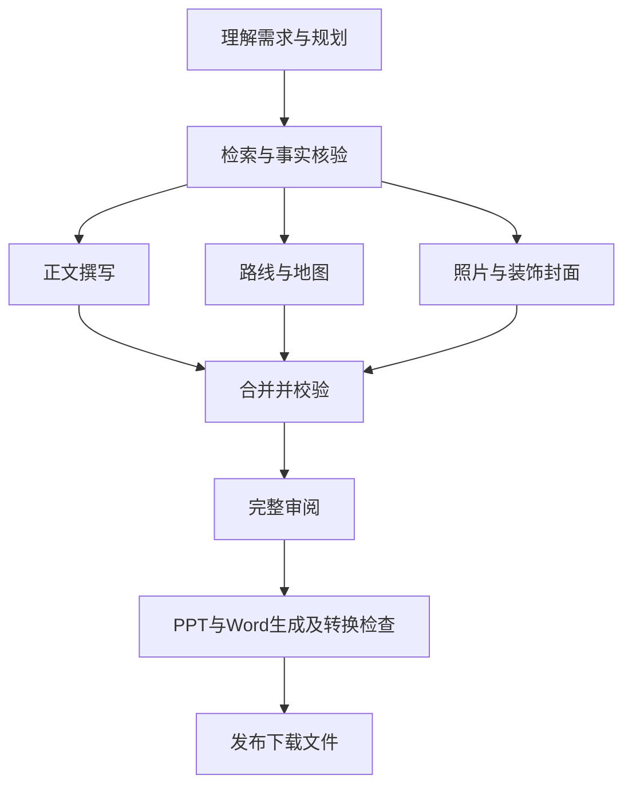

# 生成提速方案：保持现有效果与质量门槛

日期：2026-10-30。本文记录初始设计。第一轮可独立验证的优化已落地，实测范围与结果见 [实施记录](performance-implementation.md)；完整端到端收益尚未验证。

## 目标与边界

在同样的模型、内容范围、图片数量与分辨率、排版模板、引用标准和质量检查下，减少串行等待及相同输入的重复计算。不得通过减少检索范围、缩短正文、跳过照片授权或视觉核验、降低预览质量、提前发布未完成检查的文件来提速。

“效果不变”指这些可验收标准不下降。真实搜索与随机模型输出不能保证逐字或文件字节相同；对于固定资料和固定模型响应的回放测试，应保持语义结果、顺序与规则判定一致。

## 已有证据

依据 SQLite 任务事件，脱敏摘要保存在 `data/qa/performance-baseline.json`。

| 环节 | 历史阶段耗时 | 含义与局限 |
| --- | --- | --- |
| 检索资料 | 已完成历史任务约 259–749 秒 | 旧版本样本，包含不同城市与缓存情况，不能直接作为新版基线 |
| 事实核验 | 杭州首条完成记录 409 秒、上海 429 秒 | PRD 1.1 调整中的记录，后续重试因复用明显缩短 |
| 配图 | PRD 1.1 杭州、上海首条完成记录约 36、48 秒 | 当时实拍渠道未取得图片，不能代表真实照片全部可用时的耗时 |
| 最终排版及转换检查 | 三个 PRD 1.1 案例的后续完成记录约 6–12 秒 | 保留完整检查即可，优先级低于检索与核验 |
| 仅改颜色 | 两次完整修改任务约 9.6、9.5 秒 | 已经只执行修改分析与文档生成，应保留现有复用路径 |

历史记录包含多轮重试，缺少部分阶段开始时间；不能把不同轮次的阶段相加，宣称某次任务的完整耗时。实施前必须补一组当前版本冷缓存、热缓存基线。

## 第一批：先优化阶段内部，不改变业务流程

| 优先级 | 改动 | 保持效果的约束 |
| --- | --- | --- |
| P0 | 为外部调用增加计时：排队、MCP 初始化与工具发现、模型调用、抓取、向量化、重排、转换 | 只记录工具类别、耗时、命中状态和错误类型；不记录密钥或完整请求正文 |
| P1 | 检索问题按 2 路并发；独立网页最多 3 路抓取，每域名初始 1 路 | 问题数量、候选上限不变；按原问题和候选顺序合并结果，以规范网址去重，稳定分配来源编号 |
| P1 | 景点核验按 2 路并发，获取资料与事实校验仍完整执行 | 工作单元返回候选事实和来源，由单一合并点统一编号、重写引用、检查原文证据；不能直接并发修改同一个 document 或 checkpoint |
| P1 | PRD 1.1 配图的照片检索与封面生成并行；照片候选获取限 2 路 | 当前 PRD 1.1 分支仍逐景点等待，旧分支的并发不能误认为已生效；候选下载可并行，最终按固定顺序检查去重、选图，保持图片数与视觉核验不变 |
| P1 | 同一网页正文内容不变时，复用其分块向量；相同查询向量可精确命中复用 | 现有入库虽会 upsert 相同主键，但仍先计算 embedding；新键必须包含正文哈希、分块版本、embedding 模型与维度，正文或模型变更即失效 |
| P1 | 按服务复用 HTTP 连接；同一配置下复用已发现的 MCP 工具与参数映射 | 当前模型请求逐次创建 HTTP 客户端，MCP 调用逐次初始化、列工具并调用模型选工具；只有实际发现且参数语义已验证的工具才能直接构造调用，结构校验保留；服务重连、配置或工具 schema 变化须重新发现 |

并发额度按服务统一限流，而非各层分别乘起来。初始保留整任务 `Semaphore(1)`，避免同时生成多个任务放大资源争用。Nominatim 等外部服务沿用既有访问间隔；发现 429 时按现有错误恢复机制处理，并降低并发，不为测速反复冲击服务。

初期不取消入库等待：可以批量处理，但任务成功前仍确认入库成功，避免把生成完成改成后台尚未保存。

## 第二批：增加有明确失效条件的复用

项目已有搜索、抓取、路线、照片搜索与视觉核验缓存，方案是在它们之上补齐缺口，而不是再包一层通用缓存。

- **核验结果**：按准确景点/馆区、相关完整来源正文哈希、核验规则和模型版本保存。源内容或核验日期策略变化后重核；门票、预约、开放时间等字段不能直接沿用普通资料的 90 天有效期。失效后必须查源，不能以旧结果伪装为今日核验。
- **图片资产**：按图片内容哈希保留原图、许可、作者、来源页、视觉核验结果和核验版本。命中时复用完整证据；许可有效性需按策略复查。去重集合限定在本任务，不能让上个任务选过的图影响新任务。
- **合并相同在途请求**：两个工作单元同时请求同一网址或相同 embedding，只发一次，并让各自接收同一成功结果；失败保留原有诊断与重试语义，不长期缓存失败。
- **正文证据保持完整**：知识库当前返回的是文本片段；复用检索结果时仍须恢复相关完整来源，不能把一个片段当作整篇正文后跳过必要证据。
- **修改任务**：继续保持颜色只重排版的现状；正文、日期、路线、图片的缓存失效分别按实际输入依赖判断，不能以修改文案简单关键词代替依赖判断。

缓存命中也执行便宜的引用完整性、字段规则、文件存在与质量门槛检查。已核验缓存若仍有效，不需再次调用相同模型，但必须保留原核验时间和来源。

## 第三批：在内部并发稳定后再拆阶段依赖

候选依赖关系：

只有输入相同且互不改写对方结果的部分才并行。当前路线规划会剔除无法安排的景点并更新日期等信息，直接把现有三个函数放进 gather 会互相覆盖 document，不能这样实施。路线结果先决定最终景点集，再按现有规则合并正文与图片；被剔除景点的预算、用餐、正文和图片不得残留。若正文依赖最终路线，则只把与路线无关的介绍提前撰写，相关正文仍等待路线，必要重写成本计入收益。

开始时可提前生成装饰封面，但照片若按尚未筛选的景点预取，会产生额外服务开销，应单独测量。最终审阅必须等待全部结果合并，保持全量事实检查。PPT/Word 转换并发要使用独立 Office profile、目录和字体配置，Word 的目录更新仍按实际 PDF 页码迭代；该项收益较小，最后考虑。

## 收益预期与实施顺序

以下是工程目标，不是实测承诺，各项收益不可直接相加：

1. **计时与阶段内部并发**：先争取当前版本冷启动总耗时降低 25%–40%。独立等待理想情况下由各项相加接近最长批次，但限流与慢请求会削弱收益。
2. **精准缓存复用**：同城相近需求且资料有效时，争取相对其现有热缓存路径再缩短 20%–40%；全新城市可能收益很小。现有颜色修改约 10 秒，不套用这个目标。
3. **跨阶段并行**：在前两批之后，以仍存在的关键路径为准，确认有收益才实施。不要为几秒排版收益先改复杂调度。

每批独立开关、独立验收；任一质量指标下降就不启用该批。第一批主要涉及 graph.py、enrichment.py、photos.py、kb/ingest.py、llm.py 与 mcp_search.py；第三批才需要调整调度、检查点和进度界面。

## 验收办法

- 使用杭州一日攻略、上海三日攻略、西安文化介绍及颜色修改四种固定需求。先用固定来源与模型响应回放对照，再对关键路径进行真实服务对照。
- 分开记录冷缓存、热缓存、增量修改；同版本同样例成对比较，记录总墙钟耗时、各服务等待、调用数、缓存命中、错误和重试次数。少量样本只报告单次与中位数，不声称可靠 P95。
- 固定回放须保持正文、来源编号及引用关系、路线、图片选取顺序和质量判定一致。真实运行人工核对信息覆盖、引用、已核实敏感字段、图片相关性、授权、重复图和章节完整度，不能只看测试通过。
- 保留当前敏感事实门槛、每日总时长不超过 10 小时、开放时间和最后入场时间等行程约束、真实地图、图片数量与尺寸、Word 目录页码、PPT/Word 页面边界及正文清洁检查。对相同文档输入对比实际渲染，确认排版未退步。
- 验证并发时重复网址、来源编号冲突、图片去重竞态、单项超时、429、任务中断与重试；检查点只写已完成并经合并校验的结果，失败不发布半成品。
- 进度界面支持同阶段多项操作并行；若进入第三批，必须显示多个活动分支，预计完成时间按依赖图关键路径估算，不能继续把并行耗时全部相加。

建议优先落地第一批；先验证实际节省和质量等价，再决定是否推进第二、三批。
